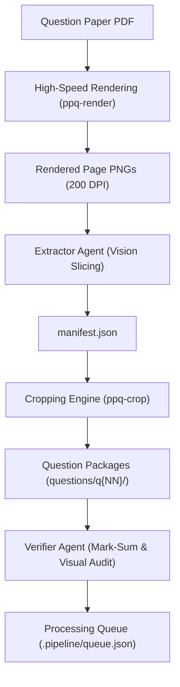

# System Architecture

This document describes the architectural principles, dataflow, coordinate systems, and storage models of **PPQ Extractor**.

---

## 1. System Overview

Cambridge Past Paper Question booklets (e.g. Cambridge International AS & A Level Mathematics, 9709) consist of top-level numbered questions, sub-components (parts), shared introductory material (preambles), and extensive answer lined workspace.

PPQ Extractor converts raw PDF booklets into modular, machine-readable **Question Packages** designed for automated grading, topic-based problem banking, and vision-language model training.



---

## 2. Decoupled Two-Agent Lifecycle

The system operates autonomously through two independent, decoupled agent roles scheduled in hourly execution containers:

### Extractor Agent
- Polls the **Processing Queue** (`.pipeline/queue.json`) for papers in `unprocessed` state.
- Executes `ppq-render` to convert PDF pages to 200 DPI PNG images.
- Invokes multimodal vision models against content pages using `prompts/vision_slicing.md`.
- Excises student **Answer Workspace** lines while preserving question text, mathematical notation, diagrams, and mark brackets.
- Generates `manifest.json` and runs `ppq-crop` to assemble modular Question Packages.
- Updates queue status to `extracted` with `--extracted-marks`.

### Verifier Agent
- Polls the queue for papers in `extracted` state.
- Audits mark-sum balance against component syllabus invariants (e.g. 75 marks for Pure 1/Pure 3, 50 marks for Mechanics/Probability).
- Checks question numeral visibility, ensuring top-level numbers (especially Question 1) were not clipped or excised.
- Performs visual reconciliation of each Question Package against source page images.
- Autonomously patches minor coordinate flaws in `manifest.json` and re-runs `ppq-crop`.
- Approves paper as `verified` or flags persistent anomalies as `needs_rework`.

---

## 3. Two-Tier Question Package Model

As formalized in [ADR 0001](adr/0001-question-package-and-decoupled-stem-architecture.md), shared preamble stems are decoupled from individual Question Parts:

```
data/output/<paper_id>/
├── manifest.json              # Whole-paper index, slices, and verification block
├── pages/                     # High-resolution rendered page images
│   ├── page_01.png
│   └── page_02.png
└── questions/
    ├── q01/
    │   ├── full.png           # Stitched Composite Question Image
    │   ├── part_a.png         # Isolated Question Part Image
    │   ├── part_b.png         # Isolated Question Part Image
    │   ├── preamble.png       # Standalone Question Preamble Image (if stem exists)
    │   └── question.json      # Atomic metadata descriptor
    └── q02/
        ├── full.png
        └── question.json
```

### Assets per Question Package

1. **Question Preamble Image (`preamble.png`)**: Standalone crop containing context, formulas, or diagrams preceding the first Question Part.
2. **Question Part Image (`part_{label}.png`)**: Isolated sub-component crop without prepending the preamble.
3. **Composite Question Image (`full.png`)**: Stitched image uniting preamble and all parts with candidate answer workspaces removed.
4. **Item Metadata (`question.json`)**: Declares marks, bounding coordinates, context dependencies (`["preamble"]`), and Syllabus Topic Codes.

---

## 4. Coordinate System & Invariants

```
0 +--------------------------------------+
  |                                      |
  |             Top Margin               |
  |                                      |
  | [ymin]                               |
  | 1. Bold Question Number              |
  |    Question stem context...          |
  | [ymax]                               |
  | - - - - - - - - - - - - - - - - - -  |
  | Excised Answer Workspace             |
  | - - - - - - - - - - - - - - - - - -  |
1000 +-----------------------------------+
```

- **Normalized Scale**: Vertical bounds are declared in a normalized `0–1000` integer space relative to page height.
- **Full-Width Crop Invariant**: Horizontal bounds span the full standardized width (0 to 1000). Slices vary only in vertical extent (`ymin` to `ymax`).
- **Question Numeral Invariant**: `ymin` must strictly encompass top-level question numerals (e.g. bold "1", "2") with an upward safety buffer of at least 15 normalized units (~15px) to prevent truncation.

---

## 5. Automatic Margin Trimming & Taxonomy

As formalized in [ADR 0002](adr/0002-syllabus-topic-taxonomy-and-margin-trimming.md):

- **Margin Trimming**: Cambridge papers from 2024 onwards feature vertical *"DO NOT WRITE IN THIS MARGIN"* warnings on outer lateral edges. The slicing tool (`tools/crop_slices.py`) automatically detects margin rule lines and suppresses these vertical bars without clipping math notation or mark tags.
- **Syllabus Topic Taxonomy**: Master syllabus registries (e.g. `data/syllabus/9709.json`) define canonical two-level dot-notation **Syllabus Topic Codes** (`1.1` Quadratics, `1.7` Differentiation). Question Packages record these at both part and question levels.
